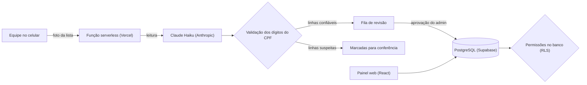

# Gamifica · Dashboard Educacional

> **Vitrine do projeto.** O código é privado porque o sistema guarda dados de alunos, muitos deles menores de idade. Aqui estão o problema, a solução, as decisões de arquitetura e os resultados.

*English summary: the official enrollment and attendance system of Gamifica, a public tech-education program in Brasília (DF). It has more than 15,000 recorded sessions, AI reading of handwritten attendance lists with CPF checksum validation, permissions enforced in the database (RLS), and 53 automated tests.*

## O problema
O Gamifica leva cursos de programação, jogos, design e marketing a escolas públicas do DF, com laboratórios móveis em 7 trilhas. A operação precisava de um registro único de inscrições e atendimentos, alimentado por listas de presença em papel e planilhas, e de números confiáveis para a prestação de contas. Também precisava proteger os dados dos alunos.

## A solução
Uma plataforma web que virou o **registro oficial** de inscrições e atendimentos do projeto:

- **Cadastro de alunos e presença** nas 7 trilhas, com busca e filtros que ficam na URL (o link já abre com o filtro).
- **Importação de planilhas**: só o nome é obrigatório; o resto é opcional.
- **Leitura de listas de presença por foto**: a equipe fotografa a lista em papel com o celular, e a IA devolve nome e CPF de cada linha.
- **Revisão e aprovação**: o que a equipe envia fica "em revisão" e só conta nos indicadores depois da aprovação de um administrador.
- **Prestação de contas**: exportação para planilhas e relatórios, e uma visão pública só com totais por região.

## Resultados
- **Mais de 15 mil atendimentos** registrados.
- Usada pela equipe no dia a dia para consultar e cadastrar inscrições.
- **53 testes automatizados**, incluindo os do próprio banco de dados.

## Arquitetura

## Decisões que valem destacar
- **Permissões aplicadas no próprio banco, não só na tela.** Três perfis: administrador, equipe e público. A visão pública mostra só totais, sem nenhum nome ou CPF. Como as regras vivem no PostgreSQL, valem mesmo para quem tentar acessar a API diretamente. Isso é essencial com dados de menores de idade, e é o que a LGPD pede.
- **IA com conferência, não com confiança cega.** A leitura por foto às vezes troca o CPF de uma linha pelo da linha de baixo. A validação dos dígitos verificadores pega a maioria dessas trocas, e nada entra no registro sem passar pela revisão.
- **Fluxo de aprovação.** A equipe cadastra e importa, mas o que ela envia só conta nos indicadores depois de aprovado. Erros não contaminam os números da prestação de contas.
- **A chave da IA nunca vai para o navegador.** A leitura das fotos roda numa função serverless.

## Stack
React · TypeScript · Vite · Tailwind CSS · TanStack Query · Zod · Supabase / PostgreSQL (RLS) · Vercel (serverless) · API da Anthropic (Claude Haiku) · Vitest

## Meu papel
Projeto de iniciativa própria: idealizei, arquitetei e desenvolvi a plataforma, e sou o administrador (reviso e aprovo o que a equipe envia).

## Telas
<!-- Coloque os prints na pasta prints/ e descomente as linhas abaixo. Use dados fictícios ou borrados: nada de nome ou CPF real. -->
<!--  -->
<!--  -->
<!--  -->
